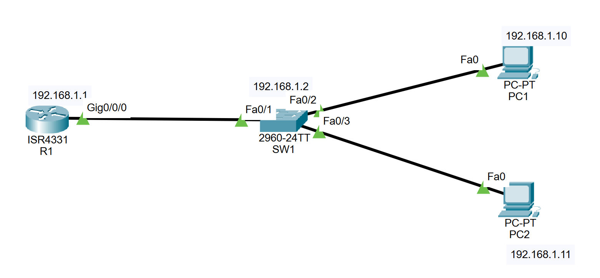
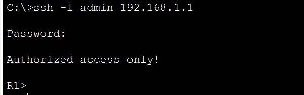

# Lab 01: Basic Device Configuration with SSH

> **Goal:** Configure a router and switch for secure remote management (SSH v2 only), then introduce a deliberate fault and diagnose it from the CLI.

**Tools:** Cisco Packet Tracer

---

## Contents

- [Topology](#topology)
- [Addressing](#addressing)
- [What I Configured](#what-i-configured)
- [Verification](#verification)
- [Fault Exercise: SSH vs Telnet on the VTY Lines](#fault-exercise-ssh-vs-telnet-on-the-vty-lines)
- [Other Issues Found Along the Way](#other-issues-found-along-the-way)
- [Files](#files)

---

## Topology



Cisco ISR4331 router (R1), Catalyst 2960-24TT switch (SW1), and two PCs, all on `192.168.1.0/24`.

**Cabling:**

| From | To |
|---|---|
| R1 `G0/0/0` | SW1 `Fa0/1` |
| PC1 `Fa0` | SW1 `Fa0/2` |
| PC2 `Fa0` | SW1 `Fa0/3` |

## Addressing

| Device | Interface | IP Address | Subnet Mask | Default Gateway |
|---|---|---|---|---|
| R1 | G0/0/0 | 192.168.1.1 | 255.255.255.0 | n/a |
| SW1 | VLAN 1 | 192.168.1.2 | 255.255.255.0 | 192.168.1.1 |
| PC1 | Fa0 | 192.168.1.10 | 255.255.255.0 | 192.168.1.1 |
| PC2 | Fa0 | 192.168.1.11 | 255.255.255.0 | 192.168.1.1 |

## What I Configured

- Hostnames, `enable secret`, `service password-encryption`, and a login banner
- A local admin user, domain name (`lab.local`), and RSA keys, with SSH restricted to version 2
- VTY lines 0-15 on both devices set to `login local` and `transport input ssh`
- R1 interface `G0/0/0`, and SW1 VLAN 1 with a default gateway

> All passwords in this lab are made up and used only here.

## Verification

| Check | Result |
|---|---|
| `show ip interface brief` | R1 `G0/0/0` up/up with 192.168.1.1; SW1 VLAN 1 up/up with 192.168.1.2 |
| `show ip ssh` | SSH enabled, version 2.0 on both devices |
| Ping from PC1 | Replies from R1, SW1, and PC2 |
| `ssh -l admin 192.168.1.1` from PC1 | Banner shown, login succeeds |



## Fault Exercise: SSH vs Telnet on the VTY Lines

**Planned fault:** Set R1's VTY lines to Telnet only, expecting SSH to be refused.

**First result:** SSH from PC1 still worked.

### Diagnosis

1. Pings to R1 succeeded, so the link and addressing were fine.
2. `show running-config | section line vty` showed `line vty 0 4` on Telnet, but `line vty 5 15` still on SSH.
3. The 4331 has 16 VTY lines and I had only changed the first five, so new SSH sessions were using lines 5-15.

### Second attempt

I applied Telnet to all lines (`line vty 0 15`). SSH from PC1 now closed immediately with no banner, while Telnet to the same address showed a login prompt:

```
C:\>ssh -l admin 192.168.1.1

[Connection to 192.168.1.1 closed by foreign host]
```

### Fix

Restored `transport input ssh` and `login local` on all VTY lines, then saved with `write memory`. SSH connected and showed the banner again.

### Takeaway

Check how many VTY lines a device has (`show line`) and apply security settings to all of them, otherwise any line left unchanged stays open. Telnet also sends credentials in clear text, which is why SSH is preferred.

## Other Issues Found Along the Way

| Issue | What happened | Resolution |
|---|---|---|
| **Interface naming** | The 4331 names its interfaces `G0/0/0`, not `G0/0` as on a 2911. | `show ip interface brief` showed the real names. |
| **Switch gateway typo** | SW1's default gateway was entered as `182.168.1.1` instead of `192.168.1.1`. It didn't affect same-subnet pings, but would have broken management from other networks. | Found while reading the config and corrected. |
| **Inconsistent login setting** | R1's VTY lines 5-15 ended up with `login` instead of `login local`, which expects a line password that isn't set. | Found by reading the config and corrected. |

## Files

| File | Description |
|---|---|
| `01-basic-config-ssh.pkt` | Packet Tracer file |
| `r1-config.txt` | Final running config for R1 |
| `sw1-config.txt` | Final running config for SW1 |
| `topology.png` | Topology screenshot |
| `ssh-success.png` | Successful SSH login from PC1 |

