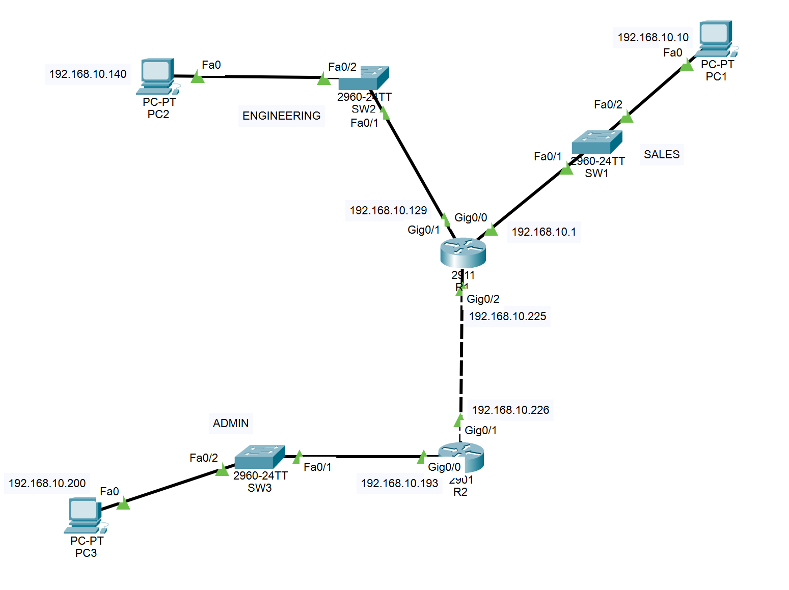
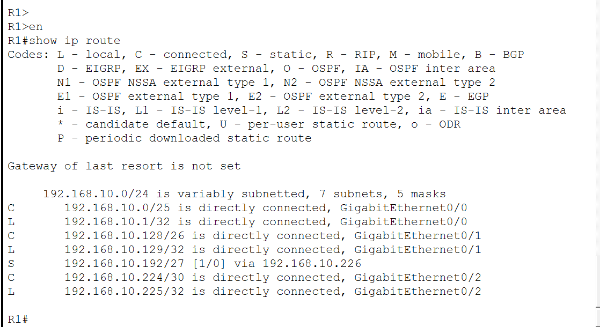
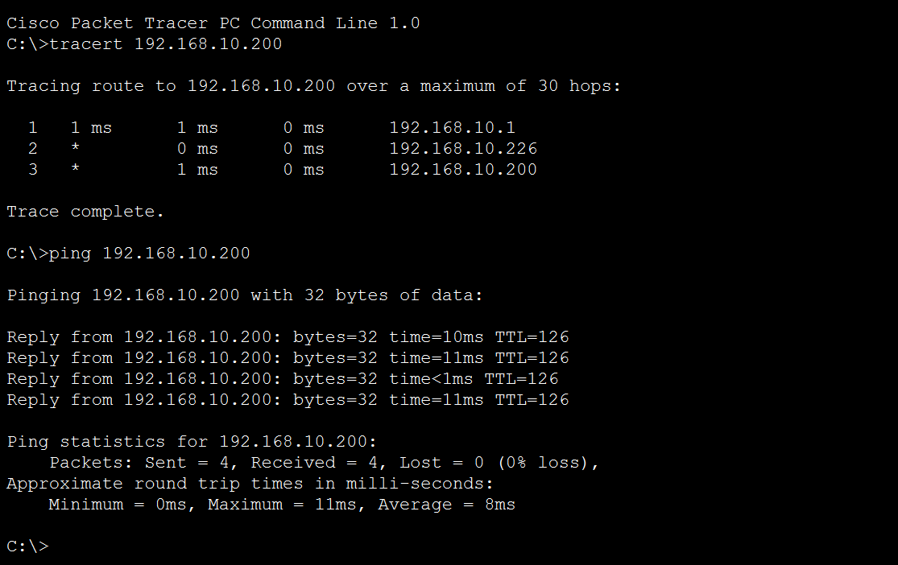

# Lab 02: Subnetting with VLSM and Static Routing

> **Goal:** Split one `/24` into differently sized subnets (VLSM) for three departments, connect them through two routers with static routes, and diagnose two faults: a missing return route and a wrong subnet mask on a PC.

**Tools:** Cisco Packet Tracer

---

## Contents

- [Topology](#topology)
- [Addressing plan](#addressing-plan)
- [How I chose the subnets](#how-i-chose-the-subnets)
- [Cabling](#cabling)
- [Static routes](#static-routes)
- [Verification](#verification)
- [Fault A: missing return route](#fault-a-missing-return-route)
- [Fault B: wrong mask on a PC](#fault-b-wrong-mask-on-a-pc)
- [Other notes](#other-notes)
- [Files](#files)

---

## Topology



Two routers (R1: Cisco 2911, R2: Cisco 2901), three Catalyst 2960-24TT switches, and one PC per department. The routers are joined by a `/30` link.

## Addressing plan

Block: `192.168.10.0/24`, allocated largest first.

| Network | Hosts needed | Subnet | Mask | Usable range | Broadcast | Gateway |
|---|---|---|---|---|---|---|
| Sales | 100 | 192.168.10.0/25 | 255.255.255.128 | .1 - .126 | .127 | 192.168.10.1 (R1 `G0/0`) |
| Engineering | 50 | 192.168.10.128/26 | 255.255.255.192 | .129 - .190 | .191 | 192.168.10.129 (R1 `G0/1`) |
| Admin | 20 | 192.168.10.192/27 | 255.255.255.224 | .193 - .222 | .223 | 192.168.10.193 (R2 `G0/0`) |
| R1-R2 link | 2 | 192.168.10.224/30 | 255.255.255.252 | .225 - .226 | .227 | n/a |

Addresses from `192.168.10.228` to `.255` are unused and left for growth.

| Device | Interface | IP Address | Mask |
|---|---|---|---|
| R1 | G0/0 | 192.168.10.1 | 255.255.255.128 |
| R1 | G0/1 | 192.168.10.129 | 255.255.255.192 |
| R1 | G0/2 | 192.168.10.225 | 255.255.255.252 |
| R2 | G0/0 | 192.168.10.193 | 255.255.255.224 |
| R2 | G0/1 | 192.168.10.226 | 255.255.255.252 |
| PC1 (Sales) | Fa0 | 192.168.10.10 | 255.255.255.128 |
| PC2 (Engineering) | Fa0 | 192.168.10.140 | 255.255.255.192 |
| PC3 (Admin) | Fa0 | 192.168.10.200 | 255.255.255.224 |

PC default gateways are the router addresses in the table above.

## How I chose the subnets

I started with the largest requirement so the blocks line up without gaps:

- **Sales (100 hosts):** 7 host bits give 2^7 - 2 = 126 usable addresses, so a `/25`.
- **Engineering (50 hosts):** 6 host bits give 62 usable, so a `/26`.
- **Admin (20 hosts):** 5 host bits give 30 usable, so a `/27`.
- **Router link (2 hosts):** 2 host bits give exactly 2 usable, so a `/30`. A point-to-point link needs only two addresses, so nothing is wasted here.

Each subnet starts where the previous one ends: `.0`, `.128`, `.192`, `.224`.

## Cabling

| Link | Network |
|---|---|
| R1 `G0/0` to SW1 `Fa0/1`; PC1 to SW1 `Fa0/2` | Sales |
| R1 `G0/1` to SW2 `Fa0/1`; PC2 to SW2 `Fa0/2` | Engineering |
| R1 `G0/2` to R2 `G0/1` | Router link |
| R2 `G0/0` to SW3 `Fa0/1`; PC3 to SW3 `Fa0/2` | Admin |

The switches use default configuration.

## Static routes

Each router only knows its directly connected networks, so each needs a route to the networks behind the other router:

```
R1: ip route 192.168.10.192 255.255.255.224 192.168.10.226
R2: ip route 192.168.10.0   255.255.255.128 192.168.10.225
R2: ip route 192.168.10.128 255.255.255.192 192.168.10.225
```

You can read each line as "to reach this network, send traffic to this next-hop address." The next hop must be an address on a network the router is directly connected to, which is why the `/30` link addresses are used.

## Verification

**Interfaces**

```
R1#show ip interface brief
GigabitEthernet0/0     192.168.10.1    YES manual up   up
GigabitEthernet0/1     192.168.10.129  YES manual up   up
GigabitEthernet0/2     192.168.10.225  YES manual up   up

R2#show ip interface brief
GigabitEthernet0/0     192.168.10.193  YES manual up   up
GigabitEthernet0/1     192.168.10.226  YES manual up   up
```

**Routing tables**

R1 has three connected networks (`C`) and one static route (`S`) to the Admin LAN:



R2 has two connected networks and two static routes:

```
R2#show ip route
     192.168.10.0/24 is variably subnetted, 6 subnets, 5 masks
S       192.168.10.0/25 [1/0] via 192.168.10.225
S       192.168.10.128/26 [1/0] via 192.168.10.225
C       192.168.10.192/27 is directly connected, GigabitEthernet0/0
L       192.168.10.193/32 is directly connected, GigabitEthernet0/0
C       192.168.10.224/30 is directly connected, GigabitEthernet0/1
L       192.168.10.226/32 is directly connected, GigabitEthernet0/1
```

`C` is a connected network, `S` is a static route I configured, and `L` is a router's own interface address, which IOS adds automatically.

**End-to-end test:** from PC1 (Sales) to PC3 (Admin), crossing both routers. The trace shows R1 (`192.168.10.1`), then R2's link address (`192.168.10.226`), then PC3. The ping succeeded with 0% loss and a TTL of 126, which is 128 minus two router hops.



## Fault A: missing return route

**Planned fault:** On R2, I removed the route to the Sales network:

```
R2(config)# no ip route 192.168.10.0 255.255.255.128 192.168.10.225
```

**Symptom:** A ping from PC1 to PC3 (`192.168.10.200`) timed out, with 4 of 4 packets lost.

**Diagnosis:** `show ip route` on R2 had no entry for `192.168.10.0/25`, and no default route (`Gateway of last resort is not set`):

```
R2#show ip route
S       192.168.10.128/26 [1/0] via 192.168.10.225
C       192.168.10.192/27 is directly connected, GigabitEthernet0/0
L       192.168.10.193/32 is directly connected, GigabitEthernet0/0
C       192.168.10.224/30 is directly connected, GigabitEthernet0/1
L       192.168.10.226/32 is directly connected, GigabitEthernet0/1
```

Everything else was configured correctly. Traffic from Sales to Admin had a path, but R2 had no way to send replies back to Sales, so it dropped them.

**Fix:** Re-added `ip route 192.168.10.0 255.255.255.128 192.168.10.225` on R2. The route reappeared as an `S` entry and PC1 could ping PC3 again.

**Takeaway:** Static routes work in one direction only. Each router needs a route for every remote network, and a ping can fail because the reply has no way back, even when the request got through.

## Fault B: wrong mask on a PC

**Planned fault:** I set PC2's subnet mask to `255.255.255.128` instead of `255.255.255.192`.

**Symptom:** Both pings worked, even though PC2 was misconfigured. PC2 could still reach PC1 and PC3.

**Diagnosis:** With the wrong mask, PC2 (`192.168.10.140`) believes its network is `192.168.10.128/25`, which includes PC3's address (`192.168.10.200`). It therefore ARPs for PC3 directly instead of sending traffic to its gateway. PC2's ARP table showed PC3's address mapped to the same MAC address as its gateway, R1's `G0/1` (`0001.c9e6.8202`):

```
C:\>arp -a
Internet Address      Physical Address      Type
192.168.10.129        0001.c9e6.8202        dynamic
192.168.10.200        0001.c9e6.8202        dynamic
```

`show ip interface g0/1` on R1 showed `Proxy ARP is enabled`. Cisco routers do this by default: R1 answered PC2's ARP request on PC3's behalf and forwarded the traffic, which hid the mistake.

**Proof:** I disabled proxy ARP on R1's `G0/1` (`no ip proxy-arp`) and cleared PC2's ARP table (`arp -d`):

- Ping to PC3 (`192.168.10.200`): 4 of 4 packets lost.
- Ping to PC1 (`192.168.10.10`): 4 of 4 replies, TTL 127. PC1 is outside PC2's mistaken `/25` range, so PC2 sends that traffic to its gateway as normal.
- PC2's ARP table now held only the gateway entry, with nothing for PC3:

```
C:\>arp -a
Internet Address      Physical Address      Type
192.168.10.129        0001.c9e6.8202        dynamic
```

**Takeaway:** A working ping doesn't prove a host is configured correctly. A router can compensate for a host's mistake, so the host's own settings (`ipconfig`) and its ARP table are worth checking.

## Other notes

- **Interface naming differs by model.** The 2911 uses `G0/0` to `G0/2`, while the 2901 has only `G0/0` and `G0/1`. I checked `show ip interface brief` on each router before configuring.
- **Router choice.** I initially planned on using an ISR4331 as R1, but it only had two usable copper ports for this build, so I used a 2911, which has three.

## Files

| File | Description |
|---|---|
| `02-subnetting-vlsm.pkt` | Packet Tracer file |
| `r1-config.txt` | Final running config for R1 |
| `r2-config.txt` | Final running config for R2 |
| `topology.png` | Topology screenshot |
| `routing-table.png` | `show ip route` on R1 |
| `ping-success.png` | Cross-subnet trace and ping from PC1 to PC3 |
