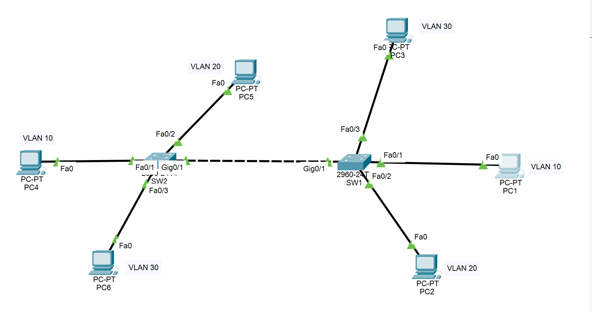
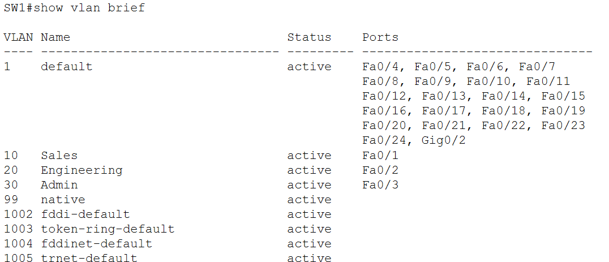
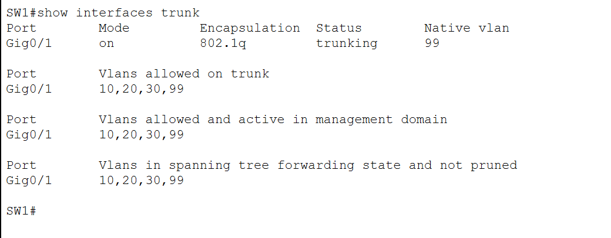
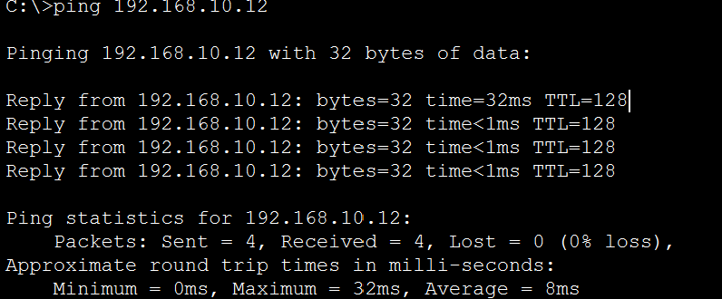

# Lab 03: VLANs and 802.1Q Trunking

> **Goal:** Segment two switches into three VLANs, connect them with a trunk, confirm that VLANs stay isolated from each other, and diagnose two deliberate faults: a VLAN removed from the trunk and a port in the wrong VLAN.

**Tools:** Cisco Packet Tracer

---

## Contents

- [Topology](#topology)
- [VLAN and addressing plan](#vlan-and-addressing-plan)
- [Cabling](#cabling)
- [Configuration summary](#configuration-summary)
- [Verification](#verification)
- [Fault A: VLAN removed from the trunk](#fault-a-vlan-removed-from-the-trunk)
- [Fault B: port in the wrong VLAN](#fault-b-port-in-the-wrong-vlan)
- [Notes](#notes)
- [Files](#files)

---

## Topology



Two Catalyst 2960-24TT switches (SW1 and SW2) joined by a trunk on `Gig0/1`, with one PC per VLAN on each switch. No router is connected, so nothing routes between VLANs in this lab.

## VLAN and addressing plan

| VLAN | Name | Subnet | Access ports (both switches) |
|---|---|---|---|
| 10 | Sales | 192.168.10.0/24 | `Fa0/1` |
| 20 | Engineering | 192.168.20.0/24 | `Fa0/2` |
| 30 | Admin | 192.168.30.0/24 | `Fa0/3` |
| 99 | native | none | none (trunk native VLAN only) |

| PC | Switch / port | VLAN | IP address | Mask |
|---|---|---|---|---|
| PC1 | SW1 `Fa0/1` | 10 | 192.168.10.11 | 255.255.255.0 |
| PC2 | SW1 `Fa0/2` | 20 | 192.168.20.11 | 255.255.255.0 |
| PC3 | SW1 `Fa0/3` | 30 | 192.168.30.11 | 255.255.255.0 |
| PC4 | SW2 `Fa0/1` | 10 | 192.168.10.12 | 255.255.255.0 |
| PC5 | SW2 `Fa0/2` | 20 | 192.168.20.12 | 255.255.255.0 |
| PC6 | SW2 `Fa0/3` | 30 | 192.168.30.12 | 255.255.255.0 |

The PCs have no default gateway because there is no router.

## Cabling

| Link | Role |
|---|---|
| SW1 `Fa0/1`, `Fa0/2`, `Fa0/3` to PC1, PC2, PC3 | Access ports |
| SW2 `Fa0/1`, `Fa0/2`, `Fa0/3` to PC4, PC5, PC6 | Access ports |
| SW1 `Gig0/1` to SW2 `Gig0/1` | 802.1Q trunk |

## Configuration summary

Both switches are configured the same way (full configs are in `sw1-config.txt` and `sw2-config.txt`):

- VLANs 10, 20, 30, and 99 created on each switch
- Access ports: `switchport mode access` with `switchport access vlan <id>`
- Trunk on `Gig0/1`:
  - `switchport mode trunk`
  - `switchport trunk native vlan 99`
  - `switchport trunk allowed vlan 10,20,30,99`

The native VLAN and the allowed list must match on both ends of the trunk.

## Verification

**VLANs exist and ports are assigned** (SW1):



`Fa0/1`, `Fa0/2`, and `Fa0/3` sit in VLANs 10, 20, and 30. The trunk port `Gig0/1` doesn't appear in this list, because trunk ports aren't members of a single VLAN.

**Trunk status** (SW1):



`Gig0/1` is trunking with 802.1Q encapsulation, native VLAN 99, and VLANs 10, 20, 30, and 99 allowed and active.

**Same-VLAN ping across the trunk:** PC1 (SW1) to PC4 (SW2), both in VLAN 10. The ping succeeded with 0% loss:



**Isolation between VLANs:** pings between PCs in different VLANs timed out. This is the expected result. Each VLAN is its own broadcast domain, and with no router, there is no path between them.

## Fault A: VLAN removed from the trunk

**Planned fault:** On SW1, I removed VLAN 20 from the trunk's allowed list:

```
SW1(config)# interface g0/1
SW1(config-if)# switchport trunk allowed vlan remove 20
```

**Result:** The Engineering ping across the switches (PC2 to PC5) timed out.

**Why:** PC2 and PC5 were still in VLAN 20 on their own switches, but the trunk no longer carried VLAN 20 traffic. The two halves of the VLAN were cut off from each other. `show interfaces trunk` lists the VLANs the trunk allows (the working state is shown above), so that's the place to check when one VLAN stops crossing a trunk.

**Fix:** `switchport trunk allowed vlan add 20`, then retested.

**Takeaway:** A VLAN existing on both switches doesn't mean it crosses the trunk. The trunk's allowed list is a separate setting.

## Fault B: port in the wrong VLAN

**Planned fault:** On SW1, I moved PC3's port into VLAN 20 instead of VLAN 30:

```
SW1(config)# interface fa0/3
SW1(config-if)# switchport access vlan 20
```

**Result:** The ping from PC3 to PC6 timed out.

**Why:** PC3 (`192.168.30.11`) and PC6 (`192.168.30.12`) share the same IP subnet, but PC3's port was now in VLAN 20 while PC6 stayed in VLAN 30. PC3's ARP request was sent into VLAN 20, so PC6 never received it. `show vlan brief` shows which VLAN each port belongs to (the working state is shown above, with `Fa0/3` under Admin).

**Fix:** `switchport access vlan 30`, then retested.

**Takeaway:** Matching IP addresses aren't enough. The switch port's VLAN has to match as well, and a wrong VLAN assignment looks just like a dead connection.

## Notes

- **VLANs are not in the running config.** On these switches the VLAN definitions don't appear in `show running-config`. They appear in `show vlan brief`.
- **Scope.** The switches have no management IP address or remote-access password, because this lab covers only VLANs and trunking.
- **Next step.** Inter-VLAN routing, so the three VLANs can communicate through a router.

## Files

| File | Description |
|---|---|
| `03-vlans-trunking.pkt` | Packet Tracer file |
| `sw1-config.txt` | Final running config for SW1 |
| `sw2-config.txt` | Final running config for SW2 |
| `topology.png` | Topology screenshot with VLAN labels |
| `vlan-brief.png` | `show vlan brief` on SW1 |
| `trunk.png` | `show interfaces trunk` on SW1 |
| `ping-success.png` | Cross-switch ping within VLAN 10 |
