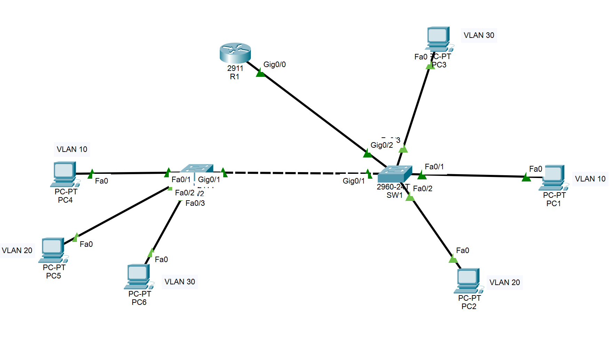
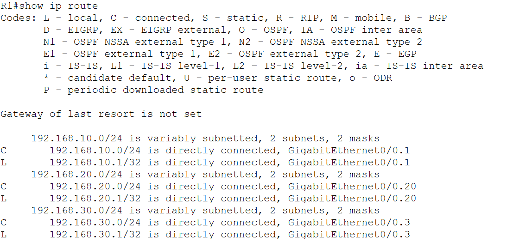
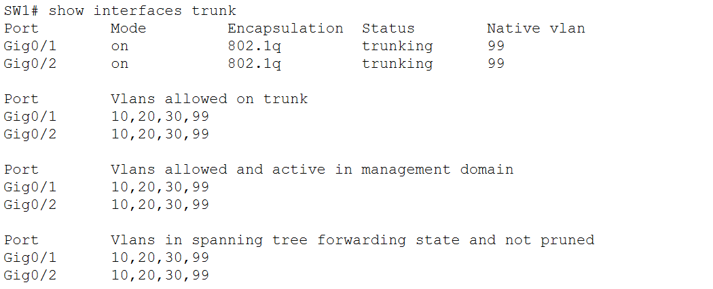
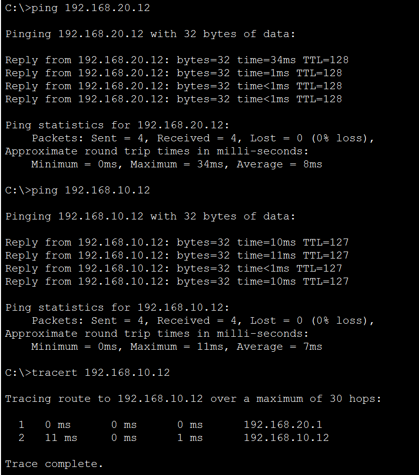
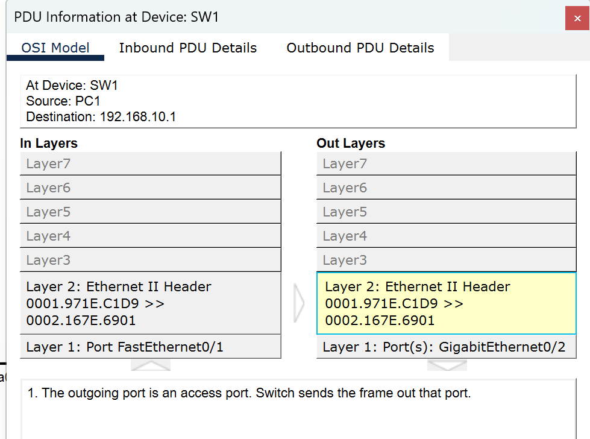
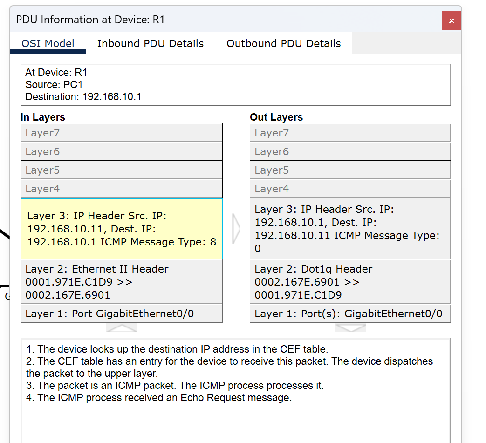
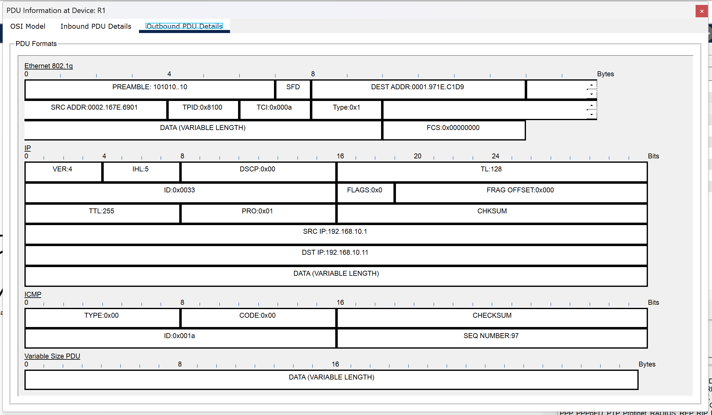

# Lab 04: Inter-VLAN Routing (Router-on-a-Stick)

> **Goal:** Add a router to the VLAN lab so devices in different VLANs can communicate, then diagnose three faults: a shut-down router interface, a switch port that isn't a trunk, and a wrong default gateway on a PC.

**Tools:** Cisco Packet Tracer

---

## Contents

- [Topology](#topology)
- [VLAN and addressing plan](#vlan-and-addressing-plan)
- [How router-on-a-stick works](#how-router-on-a-stick-works)
- [Configuration summary](#configuration-summary)
- [Verification](#verification)
- [Fault A: router interface shut down](#fault-a-router-interface-shut-down)
- [Fault B: router-facing switch port is not a trunk](#fault-b-router-facing-switch-port-is-not-a-trunk)
- [Fault C: wrong default gateway on a PC](#fault-c-wrong-default-gateway-on-a-pc)
- [Notes](#notes)
- [Files](#files)

---

## Topology



This builds on the previous lab (VLANs and trunking). The two switches and six PCs are unchanged. A Cisco 2911 router (R1) is added, connected to SW1 `Gi0/2`.

## VLAN and addressing plan

| VLAN | Name | Subnet | R1 subinterface | Gateway |
|---|---|---|---|---|
| 10 | Sales | 192.168.10.0/24 | `G0/0.10` | 192.168.10.1 |
| 20 | Engineering | 192.168.20.0/24 | `G0/0.20` | 192.168.20.1 |
| 30 | Admin | 192.168.30.0/24 | `G0/0.30` | 192.168.30.1 |
| 99 | native | none | `G0/0.99` (native, no IP) | n/a |

| PC | Switch / port | VLAN | IP address | Gateway |
|---|---|---|---|---|
| PC1 | SW1 `Fa0/1` | 10 | 192.168.10.11 | 192.168.10.1 |
| PC2 | SW1 `Fa0/2` | 20 | 192.168.20.11 | 192.168.20.1 |
| PC3 | SW1 `Fa0/3` | 30 | 192.168.30.11 | 192.168.30.1 |
| PC4 | SW2 `Fa0/1` | 10 | 192.168.10.12 | 192.168.10.1 |
| PC5 | SW2 `Fa0/2` | 20 | 192.168.20.12 | 192.168.20.1 |
| PC6 | SW2 `Fa0/3` | 30 | 192.168.30.12 | 192.168.30.1 |

All masks are `255.255.255.0`.

**New link:** R1 `G0/0` to SW1 `Gi0/2` (trunk).

## How router-on-a-stick works

VLANs are separate broadcast domains, so devices in different VLANs can't talk to each other without a router. A router with one physical port can handle this by splitting that port into subinterfaces, one per VLAN. Each subinterface is the default gateway for its VLAN. The switch port facing the router must be a trunk, so frames from all VLANs reach the router tagged with their VLAN ID.

A ping from VLAN 20 to VLAN 10 therefore goes up the trunk to R1, gets routed from the `.20` subinterface to the `.10` subinterface, and goes back down the same trunk.

## Configuration summary

Full configs are in `r1-config.txt`, `sw1-config.txt`, and `sw2-config.txt`.

**R1**
- Physical `G0/0` has no IP address and is enabled
- One subinterface per VLAN, each with `encapsulation dot1Q <vlan>` and the gateway address
- `G0/0.99` carries the native VLAN with `encapsulation dot1Q 99 native` and no IP address

**SW1**
- `Gi0/2` is a trunk to R1, with native VLAN 99 and allowed VLANs 10, 20, 30, 99 (same settings as the SW1-SW2 trunk on `Gi0/1`)

**SW2** is unchanged from the previous lab.

## Verification

**Routing table on R1:** one connected network (`C`) per VLAN, each on its own subinterface, plus the router's own addresses (`L`):



**Trunks on SW1:** both `Gi0/1` (to SW2) and `Gi0/2` (to R1) are trunking with 802.1Q, native VLAN 99, and VLANs 10, 20, 30, 99 allowed:



**Same-VLAN versus cross-VLAN ping** (from PC2 in VLAN 20):



- Ping to PC5 (`192.168.20.12`, same VLAN): 0% loss, TTL 128. The switches forward it without a router.
- Ping to PC4 (`192.168.10.12`, VLAN 10): 0% loss, TTL 127. The TTL dropped by one because the packet crossed one router.
- `tracert` to PC4: the first hop is `192.168.20.1`, R1's gateway for PC2's VLAN, and the second is PC4.

In the previous lab, the same cross-VLAN pings timed out because there was no router.

## Fault A: router interface shut down

**Planned fault:** I shut down R1's physical interface (`interface g0/0`, then `shutdown`).

**Evidence:** `show ip interface brief` on R1. The physical interface and every subinterface under it went down:

```
R1#show ip interface brief
Interface              IP-Address      OK? Method Status                Protocol
GigabitEthernet0/0     unassigned      YES unset  administratively down down
GigabitEthernet0/0.1   192.168.10.1    YES manual administratively down down
GigabitEthernet0/0.3   192.168.30.1    YES manual administratively down down
GigabitEthernet0/0.20  192.168.20.1    YES manual administratively down down
GigabitEthernet0/0.99  unassigned      YES unset  administratively down down
```

(The subinterface names `.1` and `.3` are the typo described under [Notes](#notes). This capture was taken before I renamed them.)

**Result:**
- Pings between PCs in the same VLAN still worked.
- Pings to a PC's own gateway failed, because the physical interface was down.
- Pings between VLANs failed.

**Why:** Same-VLAN traffic is switched by SW1 and SW2 and never touches the router. Subinterfaces depend on the physical interface, so shutting it down removed all three gateways at once.

**Fix:** `no shutdown` on `g0/0`. All subinterfaces came back up, and cross-VLAN pings worked again.

**Takeaway:** If same-VLAN traffic works and cross-VLAN traffic doesn't, look at the router and the link to it, not the switches.

## Fault B: router-facing switch port is not a trunk

**Planned fault:** On SW1, I changed `Gi0/2` from a trunk to an access port in VLAN 10:

```
SW1(config)# interface g0/2
SW1(config-if)# switchport mode access
SW1(config-if)# switchport access vlan 10
```

**Evidence:** `show interfaces trunk` listed only the link to SW2, and `show vlan brief` listed `Gig0/2` under VLAN 10:

```
SW1# show interfaces trunk
Port        Mode         Encapsulation  Status        Native vlan
Gig0/1      on           802.1q         trunking      99

SW1# show vlan brief
10   Sales        active    Fa0/1, Gig0/2
20   Engineering  active    Fa0/2
30   Admin        active    Fa0/3
```

**Result:**
- Devices in VLAN 10 could ping their default gateway and R1's other subinterface addresses, but could not reach endpoints in other VLANs.
- Devices in VLANs 20 and 30 could only reach endpoints in their own VLAN.

**Why:** An access port carries one VLAN. VLAN 20 and 30 traffic couldn't reach R1 at all. VLAN 10 could reach R1, and R1 could route a packet toward another VLAN, but the frame leaving R1 for that VLAN is tagged with the destination VLAN's ID, and an access port in VLAN 10 can't deliver it.

**Packet captures (Simulation mode)**, for a ping from PC1 to its gateway:

- At SW1, the frame came in on `Fa0/1` and went out `Gi0/2` as a plain Ethernet II frame. Packet Tracer noted that the outgoing port is an access port, so no tag is sent.

  

- At R1, the request arrived on `G0/0` as an untagged Ethernet II frame, and R1's reply went out with a Dot1q header.

  

- The outbound frame details show an 802.1Q tag with TPID `0x8100` and TCI `0x000a`, which is VLAN 10.

  

I didn't investigate why R1 accepted the untagged request on the VLAN 10 subinterface. This is how Packet Tracer behaved, and real hardware may handle untagged frames differently.

**Fix:** Restored the trunk settings on `Gi0/2` (`switchport mode trunk`, native VLAN 99, allowed VLANs 10, 20, 30, 99) and removed the leftover access VLAN. Cross-VLAN pings worked again.

**Takeaway:** Being able to ping the router's own addresses doesn't prove routing works. A ping to the router and a ping through it test different things.

## Fault C: wrong default gateway on a PC

**Planned fault:** On PC3 (VLAN 30), I changed the default gateway from `192.168.30.1` to `192.168.30.254`. That address is inside the subnet, but nothing uses it.

**Result:**
- PC3 could still ping PC6 (same VLAN) and `192.168.30.1` (R1's address in its own subnet).
- PC3 could not ping `192.168.10.1` or PC1 in another VLAN, and `tracert` timed out at the first hop.
- A ping from PC1 to PC3 also failed, because PC3's reply had no working gateway to return through.
- PC3's ARP table had entries for devices in its own subnet but none for `192.168.30.254`.
- As a control, PC6 (correct gateway) could still reach PC1.

**Why:** Traffic inside a subnet goes directly to the destination and never uses the gateway. Traffic for any other subnet is sent to the gateway, and here nothing answered for it. Because PC6 crossed VLANs normally, the router and switches were fine, which pointed at PC3's own settings.

**Fix:** Set the gateway back to `192.168.30.1`. PC3 could reach PC1 again.

**Takeaway:** A wrong gateway only breaks traffic that has to leave the subnet, so local pings can look healthy while the PC is cut off from everything else.

## Notes

- **Subinterface typo.** Two subinterfaces were first created as `G0/0.1` and `G0/0.3` instead of `.10` and `.30`. Routing worked anyway, because the VLAN comes from the `encapsulation dot1Q` line, which was correct. I renamed them to match the VLAN IDs.
- **Scope.** The switches have no management IP address or remote-access password, and R1 has none either, because this lab covers only inter-VLAN routing.

## Files

| File | Description |
|---|---|
| `04-inter-vlan-routing.pkt` | Packet Tracer file |
| `r1-config.txt` | Final running config for R1 |
| `sw1-config.txt` | Final running config for SW1 |
| `sw2-config.txt` | Final running config for SW2 |
| `topology.png` | Topology screenshot with VLAN labels |
| `route.png` | `show ip route` on R1 |
| `trunk.png` | `show interfaces trunk` on SW1 |
| `ping-success.png` | Same-VLAN and cross-VLAN ping, with traceroute |
| `fault-b-sw1-pdu.png` | Fault B capture at SW1 |
| `fault-b-r1-pdu.png` | Fault B capture at R1 (OSI view) |
| `fault-b-r1-outbound.png` | Fault B outbound frame at R1 (VLAN tag) |
